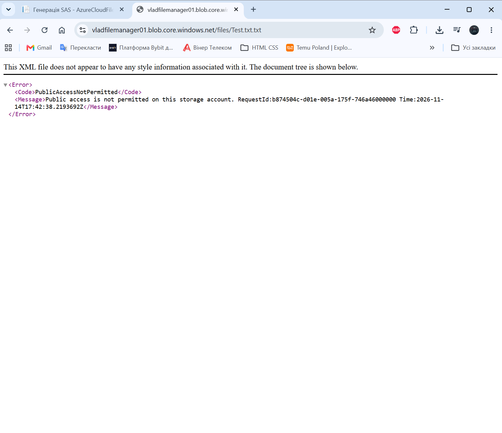
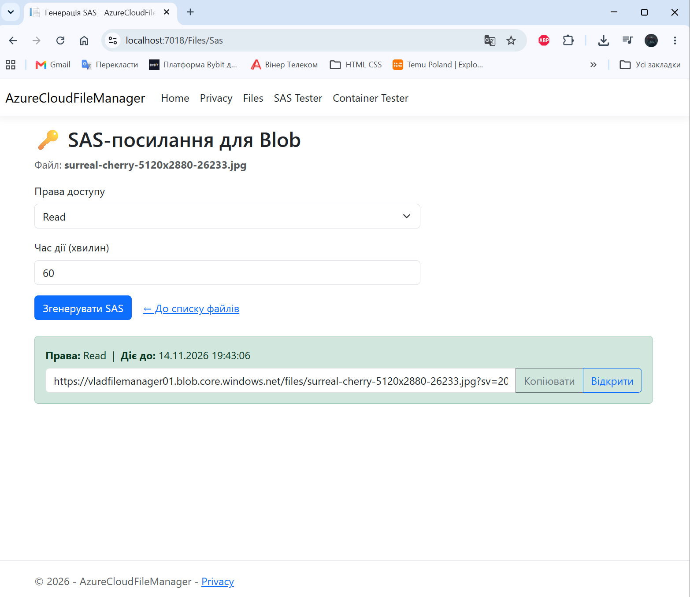
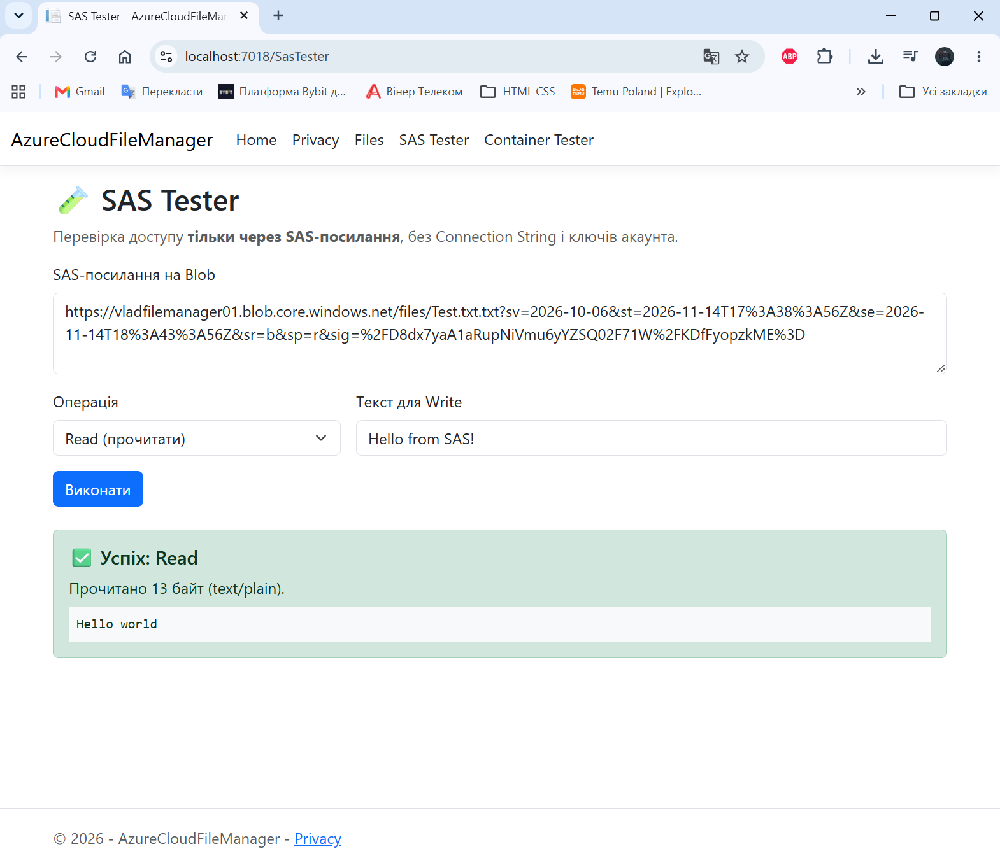
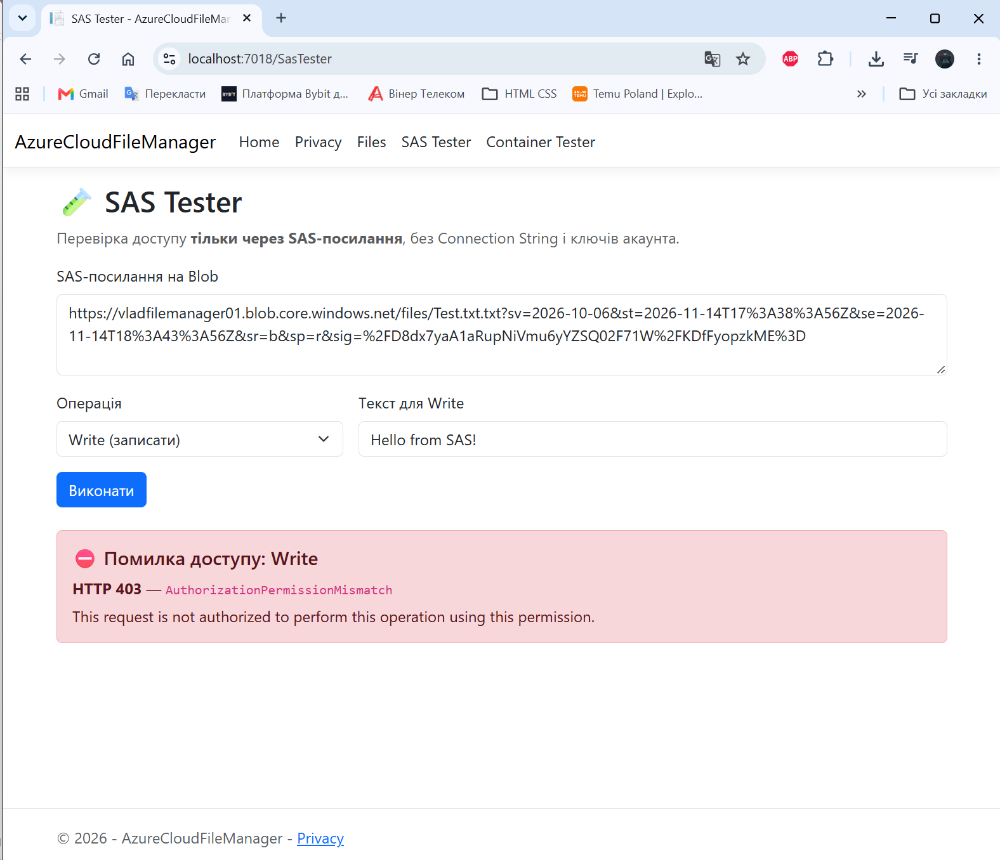
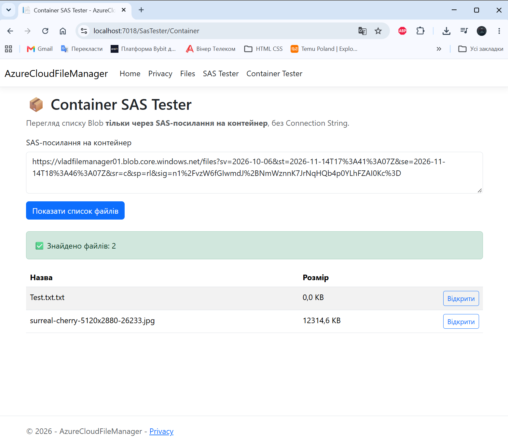

# ☁️ Azure Cloud File Manager — SAS у Blob Storage

ASP.NET Core MVC застосунок для роботи з Azure Blob Storage: завантаження, скачування,
видалення файлів і генерація **SAS-посилань** з обмеженими правами та часом дії.

## Функціонал

- Список файлів, Upload / Download / Delete (через Connection String на сервері)
- **Генерація SAS для Blob** з вибором прав: `Read`, `Write`, `Read + Write`, `Read + Delete`
- **Час дії** посилання (1 хв – 7 днів)
- **SAS Tester** — перевірка Read / Write / Delete **тільки через SAS-URL, без Connection String**
- Обробка помилки доступу (`403 AuthorizationPermissionMismatch`) для забороненої операції
- **Додатково:** SAS для Container (`Read + List` / `List` / `Read`) і перегляд списку Blob

## Технології

- .NET 10, ASP.NET Core MVC
- Azure Storage Account (Blob, LRS), приватний контейнер `files`
- `Azure.Storage.Blobs` (`BlobSasBuilder`, `BlobSasPermissions`, `BlobContainerSasPermissions`)

## Запуск

1. Створити Storage Account і приватний контейнер `files`.
2. Додати User Secrets (Connection String **не** зберігається в репозиторії):
   ```bash
   dotnet user-secrets set "AzureStorage:ConnectionString" "<connection string>"
   dotnet user-secrets set "AzureStorage:ContainerName" "files"
   ```
3. `dotnet run`

## Як це працює

SAS генерується **локально** на сервері: ключ акаунта підписує (HMAC-SHA256) параметри —
ресурс (`sr`), права (`sp`), час дії (`st`/`se`). Azure перевіряє підпис `sig` і дозволяє
лише вказані операції. SAS Tester створює `BlobClient` / `BlobContainerClient` тільки з URL —
без ключів і Connection String.

## Скріншоти

### Прямий доступ без SAS — заборонено (контейнер приватний)


### Генерація SAS-посилання


### Успішний доступ до Blob через SAS (без Connection String)


### Помилка доступу: Write з Read-only SAS → 403


### Додатково: Container SAS — перегляд списку Blob


## Матриця перевірки прав

| Blob SAS | Read | Write | Delete |
|---|---|---|---|
| Read | ✅ | ⛔ 403 | ⛔ 403 |
| Write | ⛔ 403 | ✅ | ⛔ 403 |
| Read + Write | ✅ | ✅ | ⛔ 403 |
| Read + Delete | ✅ | ⛔ 403 | ✅ |

| Container SAS | Список | Відкрити файл |
|---|---|---|
| Read + List | ✅ | ✅ |
| List | ✅ | ⛔ 403 |
| Read | ⛔ 403 | ✅ |